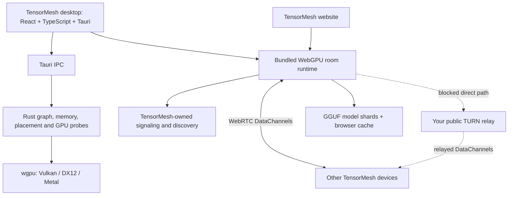
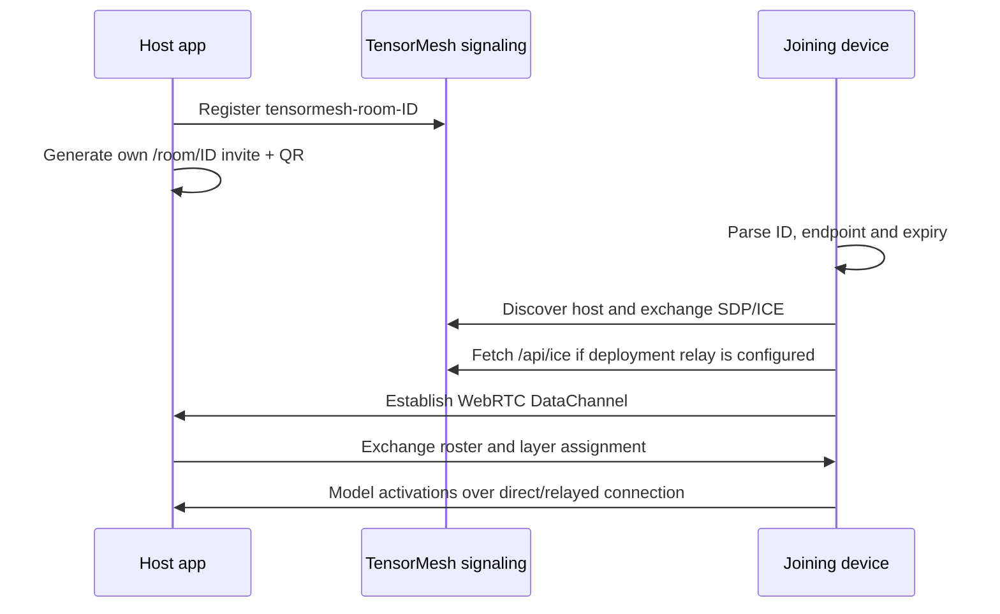

# TensorMesh

**Pool devices. Share GPU memory. Run models together.**

A standalone peer-to-peer inference workspace with a React/TypeScript interface, a Tauri desktop app, WebGPU browser execution, TensorMesh-owned room discovery, and an evolving Rust/wgpu runtime.

[Quick start](#quick-start) · [Features](#features-and-implementation-status) · [Architecture](#architecture) · [Remote rooms](#connect-across-networks) · [Tests](#verification) · [Roadmap](#roadmap)

> Development preview. Browser model execution is implemented. Full Rust-native transformer execution is still in development. Cross-network joining requires a reachable relay when direct WebRTC fails; a production TURN service has not yet been provisioned.

## Architecture



Signaling exchanges peer connection metadata. Model traffic travels over WebRTC, directly when possible and through a configured TURN relay otherwise. TensorMesh does not route invitations through an upstream hosted inference service.

## Quick start

Requires Node.js **22.18+**, npm, and a browser with WebGPU support. GPU availability depends on the device, browser and driver.

```powershell
npm ci --ignore-scripts
npm --prefix tensormesh ci --ignore-scripts
npm --prefix tensormesh run build
npm run start:local
```

Open **http://localhost:1420**. Create a room, open **Invite**, then use its link or QR code. For a local smoke test, open the invite in another tab on the same computer.

**Localhost refers to the device opening the URL.** It cannot connect a phone or another computer to the host. See the remote setup below for other devices.

<details>
<summary><strong>Build and run the desktop app</strong></summary>

On Windows, install Rust, Visual Studio C++ build tools and WebView2. Start signaling from the repository root:

```powershell
npm run signal:tensormesh
```

In a second terminal:

```powershell
cd tensormesh
npm ci
npm run tauri dev
# Build the installer:
npm run tauri build
```

The app embeds its browser runtime and exposes native adapter discovery, model metadata, graph/memory planning, placement and GPU parity probes. See [desktop setup](tensormesh/README.md) and [the rebuild helper](scripts/rebuild-desktop.ps1).

</details>

## Features and implementation status

| Area | Implementation today | Current limit |
| --- | --- | --- |
| Desktop workspace | Chat, Rooms, Models, Devices, Bench and Settings navigation; Tauri IPC | Full native model execution remains in development |
| Room invitations | Create, copy, QR, parse, validate, join; own `/room/<id>` routes and signaling namespace | Invite expiry is a client check, not signed authorization |
| Peer discovery | Self-hosted PeerServer, host/guest IDs, roster and reconnection | Host must stay available; no public signaling fallback |
| Shared GPU inference | Browser WebGPU model execution, layer assignment, shard downloads and peer activation transport | Current deployment has not reverified cross-network model inference |
| Model handling | GGUF parsing, quantized WGSL paths, tokenizer handling, weight caching and shard streaming | Model weights are downloaded separately and are not in this repository |
| Hybrid model code | Qwen hybrid attention/recurrent and MoE engine paths | Browser implementation does not imply native Rust execution parity |
| Chat and coding | Streaming chat and coding/preview harness | Uses the room's available model and shared generation queue |
| API bridge | Local CLI bridge for OpenAI-compatible and Anthropic-style requests | CLI dependencies installed separately; room host and loaded model required |
| Rust graph compiler | Explicit hybrid nodes; conservative supported fusion lowering; indirect dispatch records | GPU fusion capabilities default disabled; compiler nodes alone are not executable kernels |
| Memory planning | Static liveness, aligned activation offsets, WebGPU buffer/binding limits | Planner returns plans; weights/KV/recurrent storage are separate |
| Placement and speculation | Contiguous-layer dynamic programming, roofline lower bounds, measured-cost speculation depth selection | Utility implementation; complete native scheduler integration remains future work |
| Native GPU probes | wgpu adapter discovery and Q4 reference/parity probe code | Not proof of full-model logits or throughput parity |
| Relay integration | Own `/api/ice` endpoint issues expiring coturn credentials; browser/native room runtime loads them at join/create | Requires provisioned public coturn server and configuration; live relay not verified |
| Visual design | Vortex/Lace canvas effects, pause control, reduced-motion and hidden-tab handling | Effects are removed while a room workspace is open |

### Model catalogue

The checked-in catalogue includes Qwen3 0.6B/1.7B/4B, Qwen3.8 27B, Qwen3.6 35B MoE and SmolLM2 135M paths. The normal picker offers a subset. These are **source configuration entries**, not a claim that every external download is currently available or that every model passed a fresh end-to-end run. See [model definitions](room/models.js).

## TensorMesh-owned invite flow



Links carry only the room ID, signaling endpoint and expiry. They exclude TURN passwords, model preferences and redirect destinations. Raw room codes retain the existing host/guest semantics. Custom `tensormesh://room/...` URLs can be parsed, but OS-level deep-link registration is not implemented.

[Invite implementation](room/invite.js) · [Room controller](room.js) · [Routing and migration notes](docs/tensormesh-rooms.md)

## Connect across networks

Deploy the website and owned signaling at reachable **HTTPS/WSS** addresses. The single-origin gateway serves both:

```powershell
$env:TENSORMESH_PUBLIC_ORIGIN='https://mesh.your-domain.example'
$env:TENSORMESH_SIGNAL_URL='wss://mesh.your-domain.example/tensormesh'
npm --prefix tensormesh run build
node scripts/start-gateway.mjs
```

Put an HTTPS reverse proxy or tunnel in front of the gateway on `127.0.0.1:1421`. Example domains are placeholders; no public hosting is bundled. Rebuild desktop assets with the same configuration. A temporary tunnel URL changes when restarted; old invites then stop working.

<details>
<summary><strong>Room found, but devices cannot connect?</strong></summary>

Discovery can succeed while the WebRTC connection fails across restrictive NAT, mobile networks or firewalls. The HTTPS tunnel exposes the website/signaling; it does not supply a TURN relay.

Configure a public coturn server and set these variables on the gateway process:

```powershell
$env:TENSORMESH_TURN_URLS='turn:relay.your-domain.example:3478?transport=udp,turns:relay.your-domain.example:443?transport=tcp'
$env:TENSORMESH_TURN_SECRET='<coturn shared secret>'
node scripts/start-gateway.mjs
```

The shared secret stays on the server. Peers fetch one-hour credentials when creating/joining a room. Manual Network settings override deployment credentials. Do not put the secret into frontend builds, invites or source control.

Follow [relay setup and verification](docs/turn-relay.md). Hosting and relay bandwidth may cost money. The current credential endpoint is intended for temporary private tests; public production needs room/session authorization and issuance quotas.

</details>

### Configuration reference

| Variable | Purpose | Default |
| --- | --- | --- |
| `TENSORMESH_PUBLIC_ORIGIN` | Browser invite origin; required HTTPS origin for public gateway | `http://localhost:1420` in frontend build |
| `TENSORMESH_SIGNAL_URL` | Client-owned signaling endpoint | `ws://127.0.0.1:9000/tensormesh` |
| `TENSORMESH_SIGNAL_BIND` | Standalone signaling bind address | `127.0.0.1` |
| `TENSORMESH_SIGNAL_PORT` | Standalone signaling port | `9000` |
| `TENSORMESH_TURN_URLS` | Comma-separated public coturn URLs | Unconfigured |
| `TENSORMESH_TURN_SECRET` | Server-only timed credential secret | Unconfigured |

## Verification

<details open>
<summary><strong>Routing, isolation and relay credential tests</strong></summary>

From the root:

```powershell
node --test --test-isolation=none tests/tensormesh_invite_test.mjs tests/standalone_test.mjs tests/turn_deployment_test.mjs
node tests/gateway_flow.mjs
npm run test:invite:signal
npm --prefix tensormesh test
```

Build frontend assets before the gateway route tests. Latest local checks: **14 routing/isolation/relay unit tests passed**, **3 gateway flow checks passed**, and the frontend, native debug executable and NSIS installer built successfully. These checks do not establish live TURN allocation or cross-network GPU inference.

</details>

<details>
<summary><strong>Engine, Rust and browser integration checks</strong></summary>

```powershell
npm test
cargo test --manifest-path rust/Cargo.toml -p pooled-core --offline
cargo run --manifest-path rust/Cargo.toml -p pooled-core --example compile_graph --offline
node tests/e2e/tensormesh_invite.mjs
```

`npm test` requires Deno. Browser E2E requires Playwright Chromium or a configured `CHROMIUM` executable, built frontend assets and free local ports. GPU checks need a compatible adapter and model files. Legacy Rust crate names are retained for compatibility and attribution; they do not call an upstream hosted service.

[Kernel and GPU harnesses](tests) · [Benchmarks](benchmarks) · [Rust runtime](rust/README.md)

</details>

## Repository map

| Directory | Contents |
| --- | --- |
| `tensormesh/` | React/TypeScript UI, portable browser build, Tauri host |
| `rust/` | Graph compiler, memory/placement utilities, CPU reference and native wgpu probes |
| `engine/` | Browser execution, GGUF loading, WGSL kernels, sampling |
| `room/`, `room.js` | Invites, signaling, transport, room orchestration and recovery |
| `scripts/` | Local/public servers, coturn credentials, build helpers |
| `cli/` | Local API bridge and protocol adapters |
| `harness/` | Coding previews and model tooling |
| `tests/`, `benchmarks/` | CPU/unit, routing, browser integration and GPU measurement harnesses |
| `docs/`, `roadmap/` | Architecture, experiments and historical implementation notes |

## Roadmap

- [x] Standalone TensorMesh website and desktop shell
- [x] Own invite generation, parsing, browser routing and signaling namespace
- [x] Browser WebGPU room engine and distributed transport code
- [x] Rust graph, static activation plan and placement utilities
- [x] Server-issued coturn credentials and automatic client configuration
- [ ] Provision relay hosting and verify the two-device cross-network model flow
- [ ] Establish per-kernel and end-to-end native logit/speed parity
- [ ] Integrate Rust execution plans into complete native model inference
- [ ] Benchmark wasm dispatch overhead before browser runtime replacement
- [ ] Expand validated generated prefill kernels and autotuning
- [ ] Complete native pipeline scheduling, continuous batching and recovery gates
- [ ] Harden public room trust, credential authorization and privacy

Roadmap entries represent intended work, not advertised completed capabilities. See [Rust compiler contract](docs/rust-graph.md) and [roadmap notes](roadmap/README.md). Historical reports may describe older builds; the feature/status table above describes the current snapshot.

## License and provenance

MIT; see [LICENSE](LICENSE) and [AUTHORS](AUTHORS). TensorMesh includes adapted inference-engine code originally developed for Pooled, with original copyright notices preserved. The application uses its own room routes and signaling and does not depend on that project's hosted service. Model weights have separate licenses and are not committed.

Dependencies, compiled executables/installers, model weights, local caches and `.env` secrets are excluded from Git. Build installers from source using the desktop instructions.
